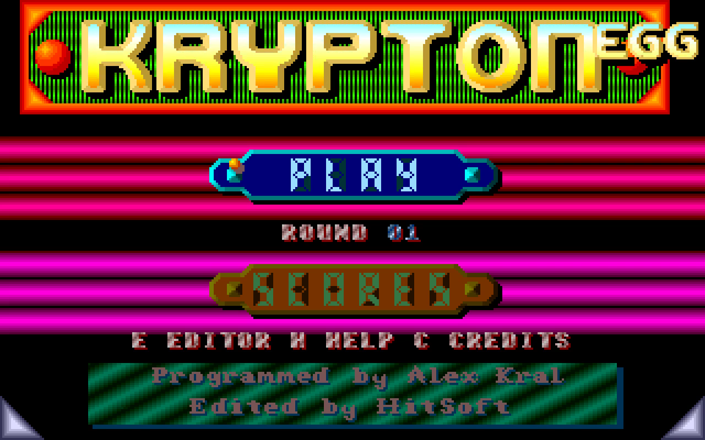
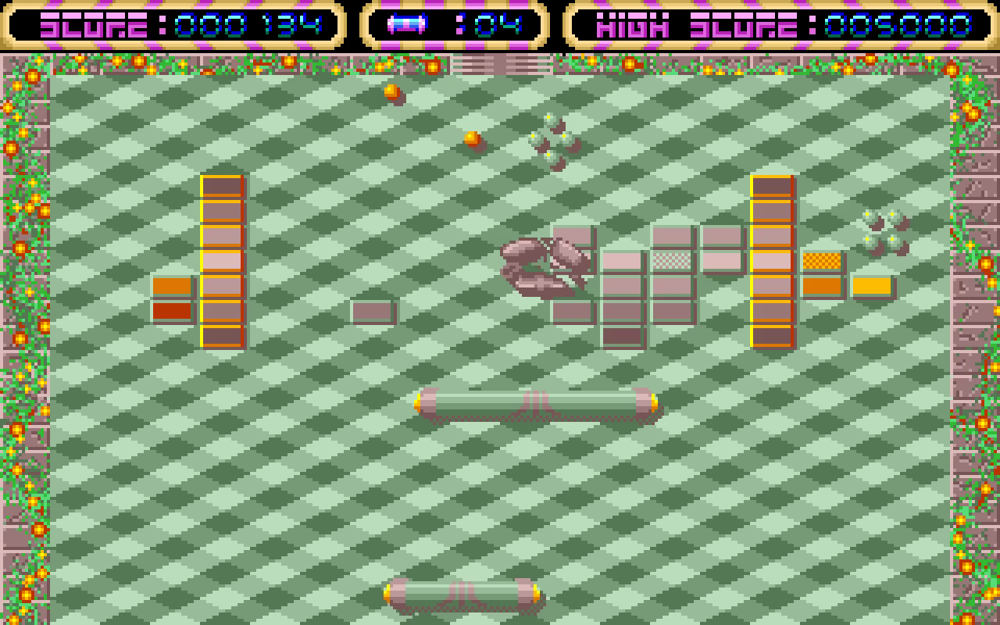
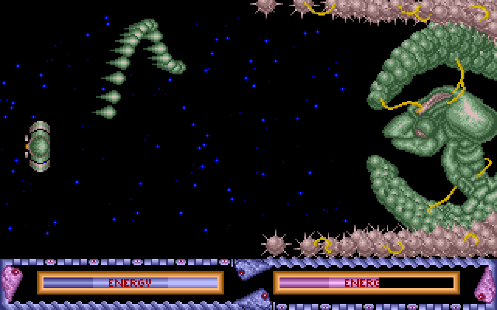
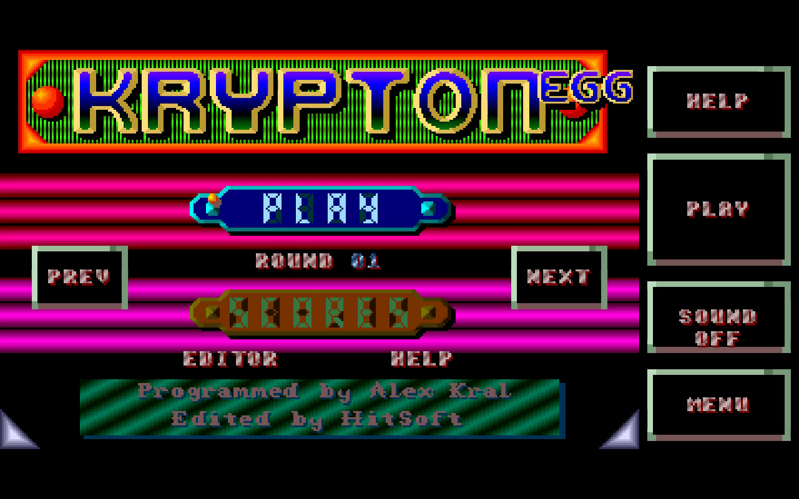

# Krypton Egg Go

A native Go/Ebitengine remake of the Amiga brick breaker **Krypton Egg** for
desktop and Android. Clear 60 original stages, collect the encoded bonuses,
defeat six alien combats and create custom levels with the construction set.

[Watch the presentation on Malakh Software](https://www.malakhsoftware.com/games.html#krytonegg).

| Menu | Gameplay |
| --- | --- |
|  |  |

| Alien combat | Android controls |
| --- | --- |
|  |  |

## Features

- Sixty stages with bricks, obstacles, teleporters, enemies and bonuses.
- Six alien combats with original artwork and rules.
- Construction set with the original 576-byte custom-level format.
- Local Hall of Fame and persistent custom level.
- Original tracker music and recovered sound effects through go-zikmu.
- Expert demonstration and campaign presentation.
- Shared desktop and Android game with mouse, keyboard, gamepad and touch input.

## Prepare the resources

The original ADF and generated assets are not included. Follow
[the asset extraction guide](docs/asset-extraction.md) before running the game.

## Desktop

Go 1.26 or newer and a desktop graphics environment are required.

```sh
python3 -m pip install -r tools/requirements.txt
make assets
make run
```

Build a standalone executable:

```sh
make build
./bin/krytonegg
```

Useful launch options:

```sh
go run . -level 12
go run . -combat 1
go run . -editor
go run . -touch
go run . -expert
```

## Controls

| Input | Action |
| --- | --- |
| Mouse, arrows or WASD | Move the paddle |
| Left click, F2 or Enter | Release an attached ball |
| Hold left click or F2 | Fire an active weapon / fire during combat |
| Space | Pause or resume |
| F1 | Switch PAL and NTSC timing |
| F3 | End the current game and return to title |
| P or Escape | Additional pause controls |
| F or F11 | Toggle fullscreen |
| M | Toggle sound |
| H | Open or close help |
| C | Show original credits from the title |
| Q | Quit from the title or pause screen |

Press **E** on the title to open the construction set. Left click paints, right
click erases, Left/Right or the wheel selects a tile, B chooses a bonus, V
changes its strength, S saves, L loads and Enter tests the level.

## Android

```sh
make android
make android-run
```

The APK is written to `android/app/build/outputs/apk/debug/app-debug.apk`.
The landscape layout places movement, Fire, Pause, Sound and Menu beside the
original picture. Scores and custom levels stay in private application storage.

## Original game credits

Krypton Egg was created and published by HitSoft. Its original name, program,
graphics, music, audio and game data remain the property of their respective
copyright holders. This independent fan remake is not affiliated with or
endorsed by the original rights holders.

